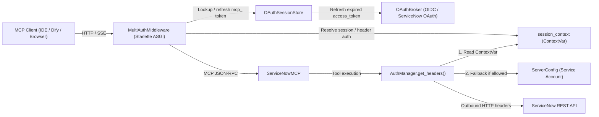

# Centralized Multi-User ServiceNow MCP Server — Design Specification

**Date:** 2026-10-18
**Status:** Draft for Review
**Target Entrypoint:** `servicenow_mcp.server_sse`

---

## 1. Goal & Problem Statement

Currently, `servicenow-mcp` in SSE mode (`src/servicenow_mcp/server_sse.py`) operates as a single-account server: it requires `SERVICENOW_USERNAME` and `SERVICENOW_PASSWORD` at startup and executes every MCP tool call using that shared ServiceNow service account, gated only by an optional static `MCP_AUTH_TOKEN`.

The goal is to turn `servicenow-mcp` into a **centralized, multi-user HTTP/SSE MCP server** that users can connect to from Developer IDEs (Cursor, Claude Code, VS Code, Claude Desktop, Windsurf) and Web AI Platforms (Dify, OpenWebUI, LibreChat) **without installing anything locally**, while authenticating with ServiceNow using each user's identity in an **OIDC-enabled ServiceNow environment**.

### Key Requirements
1. **Zero Local Installation:** Users connect over HTTP/SSE to the centralized server URL.
2. **Flexible Enterprise Provisioning:** Because ServiceNow / IAM administrators may prefer to provision either an **OIDC Client** in the corporate IdP (Okta, Entra ID, Keycloak), a **ServiceNow OAuth API Endpoint** (`System OAuth > Application Registry`), or **ServiceNow Inbound REST API Keys / Bearer Tokens**, the server must support all of these via environment configuration without code changes.
3. **IDE & Web Platform Compatibility:**
   - Support **MCP OAuth 2.1** (`/.well-known/*`, Dynamic Client Registration `/oauth/register`, PKCE `/oauth/authorize` & `/oauth/token`) so IDE clients automatically open the browser for SSO login through a single fixed redirect URI (`/oauth/callback`) registered with the corporate IdP or ServiceNow.
   - Provide a **Self-Service Web Login Portal (`GET /auth/login`)** where users can sign in via SSO in their browser and copy a ready-to-use `mcp_<token>` Bearer token, `mcp.json` snippet, or Dify header configuration.
   - Support **direct HTTP header credential pass-through** (`Authorization: Bearer <token>`, `X-ServiceNow-API-Key: <key>`, `X-ServiceNow-Basic: <base64>`).
4. **Automatic Token Refresh:** Refresh short-lived OIDC / ServiceNow OAuth `access_token` values transparently using the stored `refresh_token` so user sessions in IDEs and Dify do not break when upstream access tokens expire.
5. **Per-User Auth by Default, Opt-In Fallback:** Require per-user authentication by default (`ALLOW_SERVICE_ACCOUNT_FALLBACK=false`). Allow fallback to the server's configured ServiceNow service account only when `ALLOW_SERVICE_ACCOUNT_FALLBACK=true` is explicitly set (e.g., for shared Dify bots).
6. **Air-Gapped Compatibility:** Introduce zero new third-party Python dependencies so existing `uv.lock` and offline `wheelhouse` Docker builds remain valid.

---

## 2. Architecture & Component Boundaries



### 2.1 `src/servicenow_mcp/auth/session_context.py`
- Defines the immutable `CallerAuth` dataclass representing the resolved authentication for the current request/session:
  - `headers: Dict[str, str]` — Outbound authentication header(s) to send to ServiceNow (e.g., `{"Authorization": "Bearer ..."}` or `{"x-sn-apikey": "..."}`).
  - `auth_source: str` — Diagnostic label (`"oauth_session"`, `"bearer_passthrough"`, `"api_key"`, `"basic_passthrough"`, `"service_account"`).
  - `session_id: Optional[str]` — MCP `mcp_<token>` ID if backed by `OAuthSessionStore`.
  - `user_hint: Optional[str]` — Optional username/email/sub extracted from OIDC userinfo/JWT claims or Basic auth for `check_access`.
- Manages two context/mapping primitives:
  - `_current_caller_auth: ContextVar[Optional[CallerAuth]]` — Read by `AuthManager.get_headers()`.
  - `SseSessionAuthRegistry` — Maps MCP SSE `session_id` (from `/messages/?session_id=<uuid>`) to the `CallerAuth` established during `GET /sse`, with TTL cleanup when the `/sse` stream closes. This ensures clients that only send custom headers on `GET /sse` still have their credentials applied on subsequent `POST /messages/` calls.

### 2.2 `src/servicenow_mcp/auth/session_store.py`
- Thread/async-safe in-memory store (`OAuthSessionStore`) holding:
  1. **Active User Sessions (`mcp_<token>` -> `OAuthSession`):**
     - `mcp_token`: `"mcp_" + secrets.token_urlsafe(32)`
     - `access_token`: Upstream ServiceNow or OIDC access token
     - `refresh_token`: Optional upstream refresh token
     - `token_type`: Default `"Bearer"`
     - `expires_at`: Monotonic/epoch timestamp when `access_token` expires
     - `session_expires_at`: Epoch timestamp when the MCP session expires (`SESSION_TTL_SECONDS`, default 86400)
     - `user_hint`: Optional username or email from ID token / userinfo
  2. **Pending Authorization Flows (`state` -> `PendingAuthRequest`):**
     - Tracks in-flight browser logins initiated via `/oauth/authorize` or `/auth/login` (10-minute TTL, capped at 1,000 pending entries).
     - Stores upstream PKCE `code_verifier`, flow type (`"mcp_oauth"` vs `"portal"`), downstream IDE `redirect_uri`, `client_id`, downstream `state`, and downstream `code_challenge` / `code_challenge_method`.
  3. **Pending Downstream Authorization Codes (`code` -> `IssuedAuthCode`):**
     - Short-lived (60-second TTL, single-use) authorization codes returned to MCP IDE clients on redirect from `/oauth/callback`, exchanged at `POST /oauth/token`.
  4. **Registered Dynamic Clients (`client_id` -> `RegisteredClient`):**
     - Stores clients registered via `POST /oauth/register` (RFC 7591).

### 2.3 `src/servicenow_mcp/auth/oauth_broker.py`
- Handles upstream OAuth 2.0 / OIDC discovery, authorization URL construction, code exchange, and token refresh:
  - **Discovery:**
    - If `OIDC_ISSUER_URL` is set, fetches `<OIDC_ISSUER_URL>/.well-known/openid-configuration` (cached for 1 hour, using `settings.tls_verify()` and `settings.servicenow_timeout()`) to obtain `authorization_endpoint` and `token_endpoint`.
    - Otherwise, if `OAUTH_CLIENT_ID` is set, uses `OAUTH_AUTHORIZE_URL` (default `<SERVICENOW_INSTANCE_URL>/oauth_auth.do`) and `OAUTH_TOKEN_URL` (default `<SERVICENOW_INSTANCE_URL>/oauth_token.do`).
  - **Code Exchange & Refresh:**
    - `exchange_code_for_tokens(code, redirect_uri, code_verifier)` -> calls upstream `token_endpoint` with `grant_type=authorization_code`.
    - `refresh_access_token(refresh_token)` -> calls upstream `token_endpoint` with `grant_type=refresh_token`.
    - Extracts optional `user_hint` (`preferred_username`, `upn`, `email`, or `sub`) from JWT payload claims (base64url-decoded without logging token contents) if present.

### 2.4 `src/servicenow_mcp/auth/auth_manager.py`
- `AuthManager.__init__(config: Optional[AuthConfig], instance_url: str, session_store: Optional[OAuthSessionStore] = None, oauth_broker: Optional[OAuthBroker] = None)`:
  - `config` may be `None` when running in centralized per-user-only mode without a service account.
- `AuthManager.get_headers() -> Dict[str, str]`:
  1. Checks `get_current_caller_auth()`.
  2. If present:
     - If `caller_auth.session_id` is set and backed by `session_store`, checks if the upstream `access_token` is within 60 seconds of expiry (`expires_at - time.time() < 60`). If so and `refresh_token` is present, refreshes it via `oauth_broker` and updates the session store.
     - Returns base JSON headers (`Accept`, `Content-Type`) merged with the caller's outbound auth header.
  3. If no `CallerAuth` is set in context:
     - In `stdio` CLI mode or when service-account credentials are configured and allowed, falls back to the existing `AuthType.BASIC` / `AuthType.OAUTH` / `AuthType.API_KEY` logic on `self.config`.
     - If no service-account credentials exist (or per-user auth is required), raises `ValueError("Per-user authentication is required; no credentials found in request context.")`.

---

## 3. HTTP Endpoints & Request Flows (`src/servicenow_mcp/server_sse.py`)

### 3.1 Public / Exempt Endpoints (No Bearer Token Required)
| Method & Path | Purpose |
|---|---|
| `GET /healthz` | Liveness/readiness probe (`{"status": "ok"}`) |
| `GET /.well-known/oauth-protected-resource` | RFC 9728 metadata pointing MCP clients to the authorization server |
| `GET /.well-known/oauth-authorization-server` | RFC 8414 metadata advertising `/oauth/authorize`, `/oauth/token`, `/oauth/register` |
| `POST /oauth/register` | RFC 7591 Dynamic Client Registration for MCP IDEs |
| `GET /oauth/authorize` | Starts MCP OAuth 2.1 Authorization Code + PKCE flow; redirects to upstream IdP / ServiceNow |
| `GET /oauth/callback` | Receives upstream authorization `code`; completes Flow A (redirects to IDE) or Flow B (renders portal page) |
| `POST /oauth/token` | Exchanges downstream authorization `code` (with PKCE verification) or `refresh_token` for `mcp_<token>` |
| `GET /auth/login` | Self-service browser login entry point; redirects to upstream IdP / ServiceNow (or shows header instructions if OAuth is not configured) |

### 3.2 Authenticated Endpoints (Handled by `MultiAuthMiddleware`)
| Method & Path | Purpose |
|---|---|
| `GET /sse` | Establishes MCP SSE stream; resolves and binds `CallerAuth` |
| `POST /messages/` | Sends JSON-RPC messages over an active SSE session; restores `CallerAuth` from header or `session_id` |
| `POST /auth/logout` | Revokes the caller's `mcp_<token>` session from `OAuthSessionStore` |

### 3.3 Authentication Resolution Order in `MultiAuthMiddleware`
For every request to `/sse`, `/messages/`, or `/auth/logout`:
1. **`Authorization: Bearer mcp_<token>`:**
   - Look up in `OAuthSessionStore`. If missing or expired, return `HTTP 401`.
   - Bind `CallerAuth(auth_source="oauth_session", session_id=token, ...)`.
2. **`X-ServiceNow-API-Key: <key>`:**
   - Outbound header name from `settings.servicenow_api_key_header()` (default `x-sn-apikey`).
   - Bind `CallerAuth(headers={header_name: key}, auth_source="api_key")`.
3. **`X-ServiceNow-Basic: <base64>` or `Authorization: Basic <base64>`:**
   - Decode username hint if valid UTF-8 `user:pass`; bind `CallerAuth(headers={"Authorization": f"Basic {b64}"}, auth_source="basic_passthrough", user_hint=username)`.
4. **`Authorization: Bearer <token>` matching `MCP_AUTH_TOKEN`:**
   - If `settings.allow_service_account_fallback()` is `True` and service-account credentials are configured on the server, bind `CallerAuth` using the server's service account (`auth_source="service_account"`).
   - If `ALLOW_SERVICE_ACCOUNT_FALLBACK` is `False`, return `HTTP 401` explaining that service-account fallback is disabled.
5. **`Authorization: Bearer <external_jwt_or_sn_token>` (not starting with `mcp_` and not matching `MCP_AUTH_TOKEN`):**
   - Treat as direct OIDC / ServiceNow OAuth Bearer token pass-through: bind `CallerAuth(headers={"Authorization": f"Bearer {token}"}, auth_source="bearer_passthrough", user_hint=extracted_claim)`.
6. **No Auth Header on `POST /messages/?session_id=<id>`:**
   - Look up `<id>` in `SseSessionAuthRegistry` (populated when `GET /sse` connected). If found, bind that session's `CallerAuth`.
7. **No Auth Header on `GET /sse` when `ALLOW_SERVICE_ACCOUNT_FALLBACK=true` and `MCP_AUTH_TOKEN` is unset:**
   - If service-account credentials exist, bind `CallerAuth(auth_source="service_account")` (preserves backward compatibility for air-gapped internal deployments that explicitly opt in).
8. **Otherwise — Reject with `HTTP 401 Unauthorized`:**
   - Header: `WWW-Authenticate: Bearer resource_metadata="<public_url>/.well-known/oauth-protected-resource"`
   - Body (JSON):
     ```json
     {
       "error": "unauthorized",
       "message": "Authentication required. Sign in via OAuth, visit /auth/login to obtain a token, or pass Authorization: Bearer <token> or X-ServiceNow-API-Key.",
       "login_url": "<public_url>/auth/login"
     }
     ```

---

## 4. Configuration & Environment Variables

| Variable | Default | Required? | Description |
|---|---|---|---|
| `SERVICENOW_INSTANCE_URL` | — | **Yes** | Target ServiceNow instance URL (`https://acme.service-now.com`) |
| `MCP_PUBLIC_URL` | inferred from request | No | External base URL of this MCP server (e.g. `https://mcp-snow.example.com`) |
| `OIDC_ISSUER_URL` | unset | No | OIDC Provider issuer URL (auto-discovers `.well-known/openid-configuration`) |
| `OAUTH_CLIENT_ID` | unset | No | OAuth 2.0 Client ID (in OIDC IdP or ServiceNow Application Registry) |
| `OAUTH_CLIENT_SECRET` | unset | No | OAuth 2.0 Client Secret |
| `OAUTH_AUTHORIZE_URL` | `<instance>/oauth_auth.do` | No | Override OAuth authorization endpoint |
| `OAUTH_TOKEN_URL` | `<instance>/oauth_token.do` | No | Override OAuth token endpoint |
| `OAUTH_SCOPES` | `openid profile email` (OIDC) / `""` (SN) | No | Space-separated OAuth scopes |
| `SERVICENOW_API_KEY_HEADER` | `x-sn-apikey` | No | Header sent to ServiceNow when client supplies `X-ServiceNow-API-Key` |
| `ALLOW_SERVICE_ACCOUNT_FALLBACK` | `false` | No | Allow requests using `MCP_AUTH_TOKEN` (or unauthenticated if no `MCP_AUTH_TOKEN` is set) to use the server's service account |
| `SERVICENOW_USERNAME` / `SERVICENOW_PASSWORD` | unset | Only if `ALLOW_SERVICE_ACCOUNT_FALLBACK=true` | Service account Basic Auth credentials |
| `MCP_AUTH_TOKEN` | unset | No | Shared Bearer token that selects the service account when `ALLOW_SERVICE_ACCOUNT_FALLBACK=true` |
| `SESSION_TTL_SECONDS` | `86400` | No | Lifetime in seconds for `mcp_<token>` sessions |

---

## 5. `check_access` Per-User Identity Resolution

In `src/servicenow_mcp/tools/access_tools.py`, `_user_identity(config, auth_manager)` currently inspects `config.auth.basic.username` and reports `"No username configured (API key / client credentials); identity unknown."` for non-Basic auth.

We will update `_user_identity` so that:
1. It checks `get_current_caller_auth()` first for `auth_source` and `user_hint` (if available).
2. If a username is known (from `user_hint` or `config`), it queries `table/sys_user` by `user_name=<username>` (or `email=<user_hint>` if `user_hint` contains `@` and `user_name` returns no record).
3. If no username is known ahead of time (e.g., API key or opaque ServiceNow OAuth token), it queries `table/sys_user` with `sysparm_query=sys_id=javascript:gs.getUserID()`, which ServiceNow evaluates server-side to the authenticated caller's `sys_id`.

---

## 6. Error Handling & Security Considerations

- **Never Log Secrets or Tokens:** Neither `MultiAuthMiddleware`, `OAuthBroker`, nor `OAuthSessionStore` may log `Authorization` headers, `X-ServiceNow-API-Key`, `access_token`, `refresh_token`, or `client_secret` at any log level.
- **Redirect URI Validation in `/oauth/register` and `/oauth/authorize`:**
  - Dynamic Client Registration (`/oauth/register`) only accepts loopback redirect URIs (`http://127.0.0.1:*`, `http://localhost:*`, `http://[::1]:*`) or custom IDE URI schemes (`cursor://...`, `vscode://...`, `claude://...`, `windsurf://...`) to prevent open-redirect phishing.
  - `/oauth/authorize` requires PKCE (`code_challenge` with `code_challenge_method=S256`) and validates that `redirect_uri` matches the registered client's `redirect_uris`.
- **HTML Escaping in `/auth/login` and `/oauth/callback`:** Any error message or user hint rendered in the self-service HTML portal is escaped via `html.escape()`.
- **Updated Unauthorized Error Hint (`utils/http.py`):**
  - `_ERROR_HINTS["unauthorized"]` is updated to:
    `"ServiceNow rejected the credentials (HTTP 401). Verify your OAuth/OIDC token, API key, or service account credentials, or re-authenticate via /auth/login."`

---

## 7. Testing Strategy

1. **`tests/test_session_context_and_auth.py`:**
   - Verify `ContextVar` isolation across concurrent async tasks.
   - Verify `AuthManager.get_headers()` priority: `mcp_` session token (with and without token refresh), `X-ServiceNow-API-Key`, `X-ServiceNow-Basic`, Bearer JWT pass-through, and service-account fallback.
   - Verify `AuthManager.get_headers()` raises a clear `ValueError` when no caller auth is in context and no service account is configured.
2. **`tests/test_oauth_broker_and_portal.py`:**
   - Test `/.well-known/oauth-protected-resource` and `/.well-known/oauth-authorization-server` discovery responses.
   - Test full MCP OAuth 2.1 flow: `POST /oauth/register` -> `GET /oauth/authorize` (PKCE S256) -> mocked upstream `/oauth_token.do` / OIDC token exchange -> `GET /oauth/callback` -> `POST /oauth/token` -> `mcp_<token>` issued -> `POST /oauth/token` with `grant_type=refresh_token`.
   - Test open-redirect rejection on `/oauth/register` for non-loopback `https://evil.example.com` URLs.
   - Test `GET /auth/login` -> `GET /oauth/callback` self-service HTML portal and `POST /auth/logout` session revocation.
3. **`tests/test_server_sse_multiauth.py`:**
   - Test `MultiAuthMiddleware` with Starlette `TestClient`:
     - Unauthenticated `/sse` returns `401` with `WWW-Authenticate` resource metadata header.
     - Per-user headers on `/sse` bind to `session_id` and propagate to `/messages/?session_id=...`.
     - `ALLOW_SERVICE_ACCOUNT_FALLBACK=false` vs `true` behavior with `MCP_AUTH_TOKEN`.
     - Server startup succeeds with only `SERVICENOW_INSTANCE_URL` set when `ALLOW_SERVICE_ACCOUNT_FALLBACK=false`, and fails fast if `ALLOW_SERVICE_ACCOUNT_FALLBACK=true` without service account credentials.
4. **`tests/test_access_tools_identity.py`:**
   - Verify `check_access` resolves per-user identity via `user_hint` and via `sys_id=javascript:gs.getUserID()` when authenticating with OAuth/API key.
